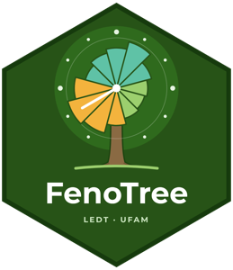

[{width=160 fig-align="center" fig-alt="Logo do FenoTree"}](https://ledtufam.shinyapps.io/fenotree/){target="_blank"}

Quando uma espécie floresce? Quando frutifica? O LEDT lançou o **FenoTree**, um aplicativo on-line, aberto e gratuito, que responde a essas perguntas a partir das **exsicatas de herbário**. Funciona direto no navegador, sem instalar nada.

## Como funciona

Basta digitar o nome da espécie. O FenoTree:

1.  busca os registros de herbário na rede [speciesLink](https://specieslink.net/){target="_blank"}, incluindo os **sinônimos** da [Flora e Funga do Brasil](https://floradobrasil.jbrj.gov.br/){target="_blank"};
2.  identifica **flores e frutos** nas anotações das etiquetas;
3.  monta o **calendário de floração e frutificação**, com resumo, calendário circular, esforço de coleta mês a mês, mapa das coletas e o texto de cada etiqueta para conferir.

As figuras e tabelas podem ser baixadas, e dá para filtrar a região: todo o Brasil, bioma Amazônia, Amazônia Legal, Panamazônia ou estados escolhidos.

## Para quem é

Para estudantes, professores, pesquisadores e quem trabalha com coleta de sementes, restauração ou viveiros e precisa saber a época de flor e fruto de uma árvore. Nas aulas de **Dendrologia Tropical (FGD921)**, o FenoTree acompanha a [atividade de calendários fenológicos](../../../extensao/rlab/rotinas/fenologia-specieslink.qmd).

O aplicativo está em **português, inglês e espanhol** e o código é aberto (licença MIT).

::: {.callout-tip appearance="simple" icon="false"}
**Um cuidado:** dados de herbário não substituem o monitoramento fenológico no campo. O esforço de coleta muda entre meses e regiões, por isso compare o número de registros com a **proporção** das coletas e confira algumas etiquetas.
:::

<a href="https://ledtufam.shinyapps.io/fenotree/" target="_blank" class="btn btn-success btn-sm"><i class="bi bi-box-arrow-up-right"></i> Abrir o FenoTree</a> <a href="../../../extensao/ferramentas.qmd#fenotree" class="btn btn-outline-success btn-sm"><i class="bi bi-info-circle"></i> Saiba mais</a> <a href="https://github.com/ledtufam/fenotree" target="_blank" class="btn btn-outline-success btn-sm"><i class="bi bi-github"></i> Código</a>
