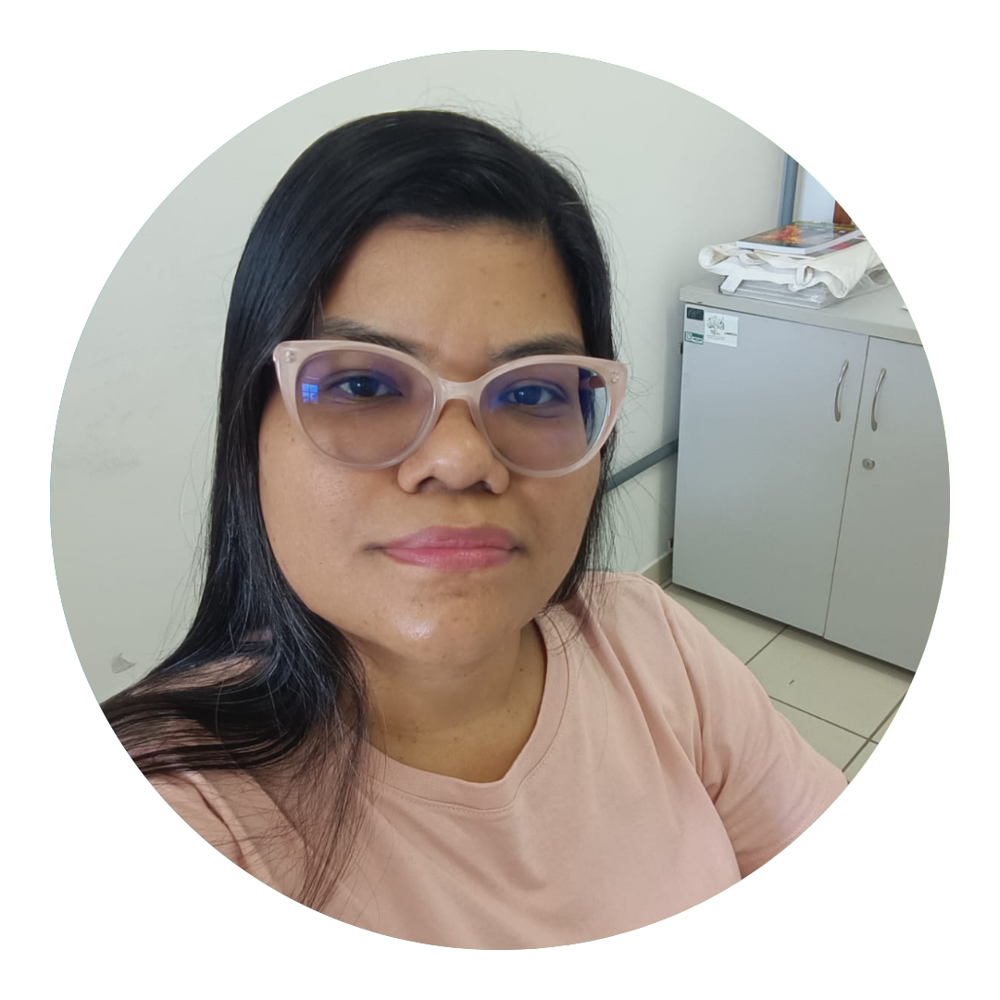
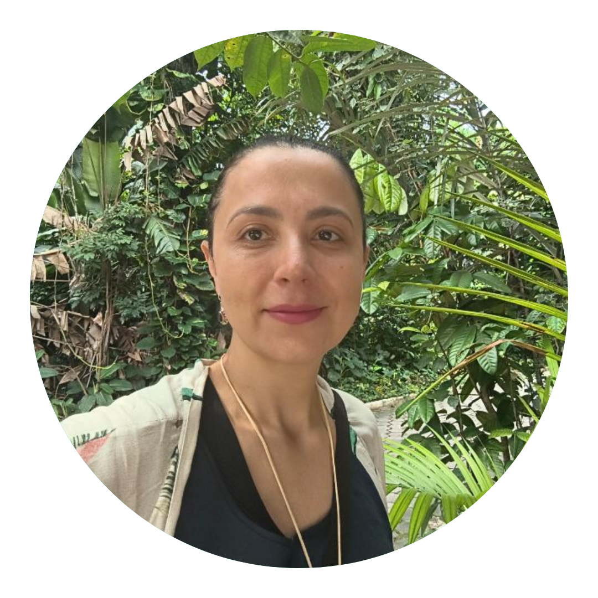
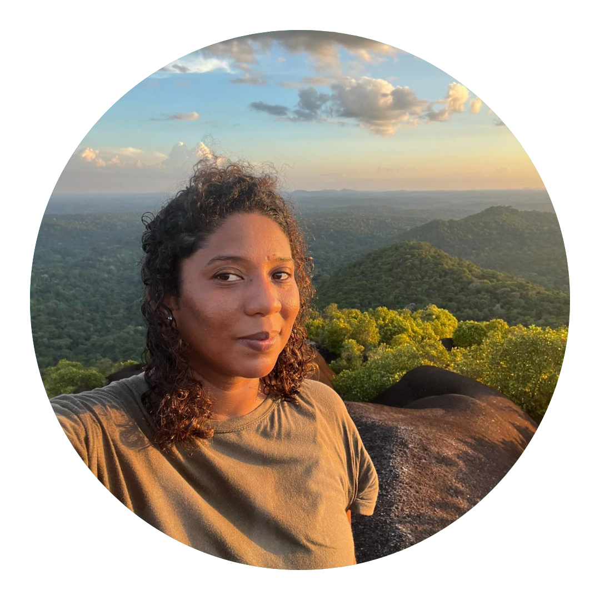
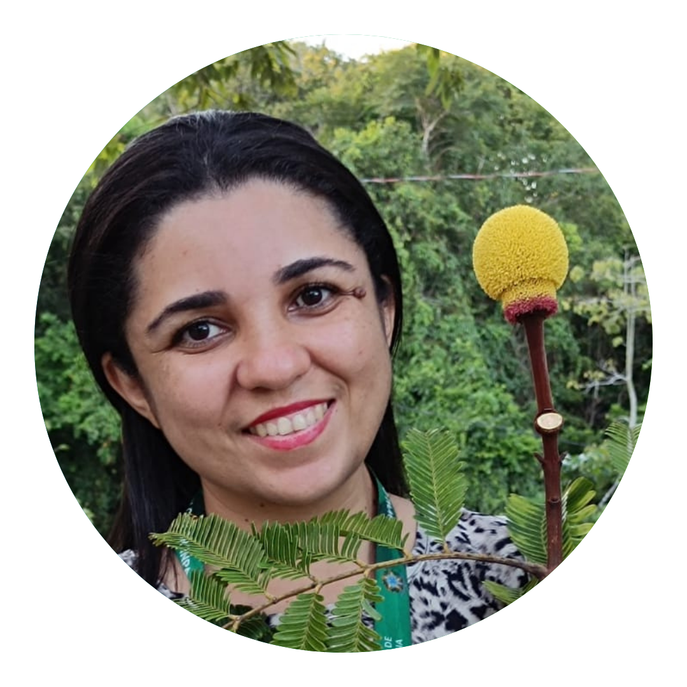
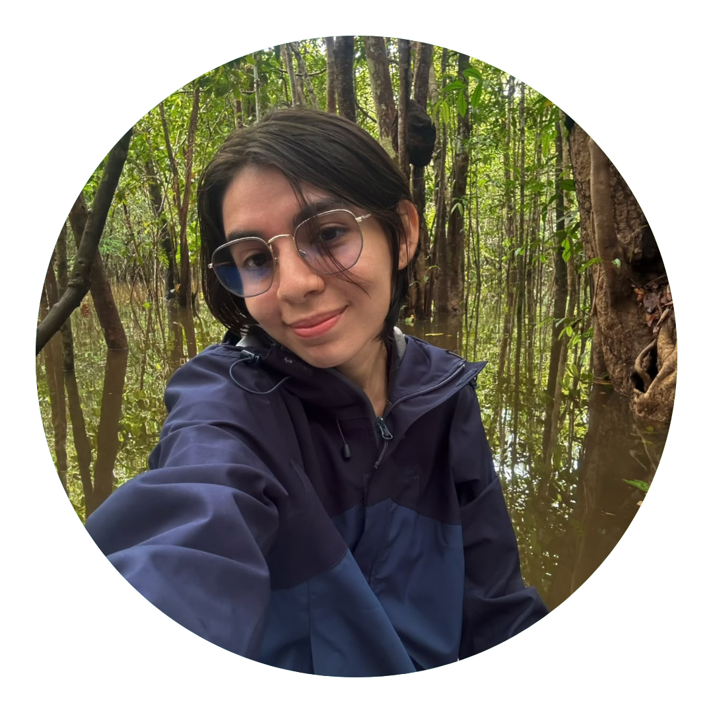
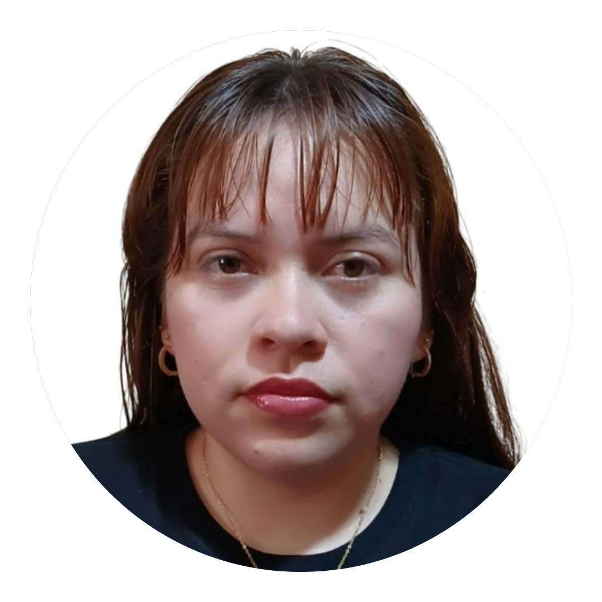
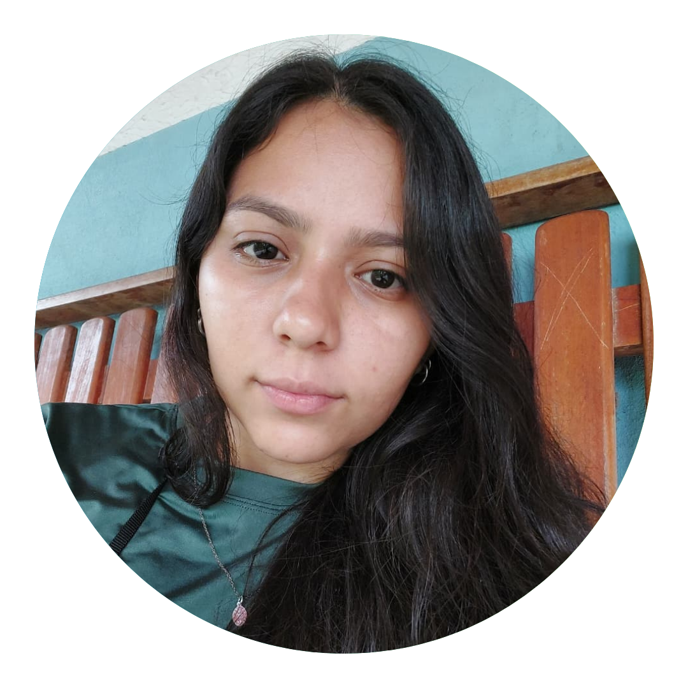

### Coordination

:::::: columns
::: {.column width="25%"}
{.img-fluid .rounded-circle width="180"}
:::

:::: {.column width="75%"}
#### Caroline C. Vasconcelos (she/her)

**Assistant Professor, PhD \| Department of Forest Sciences**\
Federal University of Amazonas (UFAM)

Research interests: Integrative taxonomy and systematics; Amazonian tree flora; Sapotaceae; Spectral digitization; Herbaria; Forest ecology

::: person-links

<a href="http://lattes.cnpq.br/1535461703335857" title=""> {alt="" width="22"} </a>

<a href="https://www.researchgate.net/profile/Caroline-Vasconcelos" title=""> {alt="" width="22"} </a>

:::
::::
::::::

### Collaborating researchers

:::::: columns
::: {.column width="25%"}
{.img-fluid .rounded-circle width="180"}
:::

:::: {.column width="75%"}
#### Flávia Machado Durgante (she/her)

**Researcher, PhD \| Environmental Dynamics Division**\
National Institute of Amazonian Research (INPA)

Research interests: Forest ecology and management

::: person-links

<a href="http://lattes.cnpq.br/9866263113578229" title=""> {alt="" width="22"} </a>

<a href="https://www.researchgate.net/profile/Flavia-Durgante" title=""> {alt="" width="22"} </a>

:::
::::
::::::

:::::: columns
::: {.column width="25%"}
{.img-fluid .rounded-circle width="180"}
:::

:::: {.column width="75%"}
#### Yêda Maria Boaventura Corrêa Arruda (she/her)

**Associate Professor, PhD \| Department of Biology, Institute of Biological Sciences**\
Federal University of Amazonas (UFAM)

Research interests: forest seeds; forest species; Amazonia; native species; dormancy; urban forestry; urban planning and management

::: person-links

<a href="http://lattes.cnpq.br/0546454617072726" title=""> {alt="" width="22"} </a>

<a href="https://www.researchgate.net/profile/Yeda-Arruda" title=""> {alt="" width="22"} </a>

:::
::::
::::::

:::::: columns
::: {.column width="25%"}
{.img-fluid .rounded-circle width="180"}
:::

:::: {.column width="75%"}
#### Gabrielly Guabiraba Ribeiro (she/her)

**PhD student \| Graduate Program in Botany**\
Instituto de Pesquisas Jardim Botânico do Rio de Janeiro (JBRJ)

Research interests: Taxonomy and biogeography; *Ormosia* (Leguminosae); Forest ecology

::: person-links

<a href="http://lattes.cnpq.br/4435352680317467" title=""> {alt="" width="22"} </a>

<a href="" title=""> {alt="" width="22"} </a>

:::
::::
::::::

:::::: columns
::: {.column width="25%"}
{.img-fluid .rounded-circle width="180"}
:::

:::: {.column width="75%"}
#### Samyra Ramos Chaves (she/her)

**Research fellow, PhD \| MAUA Group**\
National Institute of Amazonian Research (INPA)

Research interests: Reproductive biology; *Parkia* (Leguminosae); Spectral digitization; Herbaria

::: person-links

<a href="http://lattes.cnpq.br/1333559162162849" title=""> {alt="" width="22"} </a>

<a href="https://www.researchgate.net/profile/Samyra-Chaves" title=""> {alt="" width="22"} </a>

:::
::::
::::::

:::::: columns
::: {.column width="25%"}
{.img-fluid .rounded-circle width="180"}
:::

:::: {.column width="75%"}
#### Kaio Cesar Marinho da Cunha (he/him)

**Research fellow, MSc \| MAUA Group**\
National Institute of Amazonian Research (INPA)

Research interests: Integrative taxonomy and systematics; Sapotaceae; Spectral digitization; Herbaria

::: person-links

<a href="http://lattes.cnpq.br/2664299098538335" title=""> {alt="" width="22"} </a>

<a href="https://www.researchgate.net/profile/Kaio-Da-Cunha" title=""> {alt="" width="22"} </a>

:::
::::
::::::

### Students

#### Graduate students

:::::: columns
::: {.column width="25%"}
{.img-fluid .rounded-circle width="180"}
:::

:::: {.column width="75%"}
##### Túlio Alex Martins da Silva (he/him)

**PhD student \| Graduate Program in Botany**\
National Institute of Amazonian Research (INPA)

Research interests: Taxonomy and systematics; Reproductive biology; Euphorbiaceae

::: person-links

<a href="http://lattes.cnpq.br/7937040274378072" title=""> {alt="" width="22"} </a>

<a href="https://www.researchgate.net/profile/Tulio-Martins-Da-Silva" title=""> {alt="" width="22"} </a>

:::
::::
::::::

:::::: columns
::: {.column width="25%"}
{.img-fluid .rounded-circle width="180"}
:::

:::: {.column width="75%"}
##### Maria Clara A. M. de O. Ramos Ferro (she/her)

**MSc student \| Graduate Program in Botany**\
National Institute of Amazonian Research (INPA)

Research interests: NIR spectroscopy as a tool for plant taxonomy

::: person-links

<a href="http://lattes.cnpq.br/8490385946321507" title=""> {alt="" width="22"} </a>

<a href="" title=""> {alt="" width="22"} </a>

:::
::::
::::::

#### Undergraduate researchers (volunteers)

:::::: columns
::: {.column width="25%"}
{.img-fluid .rounded-circle width="180"}
:::

:::: {.column width="75%"}
##### Ana Graciela Oliveira Mayo (she/her)

**Undergraduate student \| Forest Engineering**\
Federal University of Amazonas (UFAM)

Research interests: Spectroscopy applied to the identification of commercial trees; Herbaria

::: person-links

<a href="https://lattes.cnpq.br/1877297301223493" title=""> {alt="" width="22"} </a>

<a href="" title=""> {alt="" width="22"} </a>

:::
::::
::::::

:::::: columns
::: {.column width="25%"}
{.img-fluid .rounded-circle width="180"}
:::

:::: {.column width="75%"}
##### Aynê Carolyne Silva Sá (she/her)

**Undergraduate student \| Forest Engineering**\
Federal University of Amazonas (UFAM)

Research interests: Ecology and dendrology; teaching trail; forest species

::: person-links

<a href="http://lattes.cnpq.br/0238654391031764" title=""> {alt="" width="22"} </a>

<a href="" title=""> {alt="" width="22"} </a>

:::
::::
::::::

:::::: columns
::: {.column width="25%"}
{.img-fluid .rounded-circle width="180"}
:::

:::: {.column width="75%"}
##### André Luiz da Silva Melo (he/him)

**Undergraduate student \| Forest Engineering**\
Federal University of Amazonas (UFAM)

Research interests: Dendrology

::: person-links

<a href="http://lattes.cnpq.br/7903256480417228" title=""> {alt="" width="22"} </a>

<a href="" title=""> {alt="" width="22"} </a>

:::
::::
::::::

:::::: columns
::: {.column width="25%"}
{.img-fluid .rounded-circle width="180"}
:::

:::: {.column width="75%"}
##### Heyder Loureiro Pinagé Neto (he/him)

**Undergraduate student \| Forest Engineering**\
Federal University of Amazonas (UFAM)

Research interests: Dendrology

::: person-links

<a href="" title=""> {alt="" width="22"} </a>

<a href="" title=""> {alt="" width="22"} </a>

:::
::::
::::::

:::::: columns
::: {.column width="25%"}
{.img-fluid .rounded-circle width="180"}
:::

:::: {.column width="75%"}
##### Vitor Hugo Santos Silva (he/him)

**Undergraduate student \| Forest Engineering**\
Federal University of Amazonas (UFAM)

Research interests: Dendrology

::: person-links

<a href="" title=""> {alt="" width="22"} </a>

<a href="" title=""> {alt="" width="22"} </a>

:::
::::
::::::

#### Undergraduate researchers (fellows)

:::::: columns
::: {.column width="25%"}
{.img-fluid .rounded-circle width="180"}
:::

:::: {.column width="75%"}
##### Eliandra Rodrigues Ferreira (she/her)

**Undergraduate student \| Biological Sciences**\
Federal University of Amazonas (UFAM)

Research interests: Spectroscopy applied to plant identification; Herbaria; Meliaceae; Fabaceae; CITES-listed species

::: person-links

<a href="" title="http://lattes.cnpq.br/3358526069960413"> {alt="" width="22"} </a>

<a href="" title=""> {alt="" width="22"} </a>

:::
::::
::::::

:::::: columns
::: {.column width="25%"}
{.img-fluid .rounded-circle width="180"}
:::

:::: {.column width="75%"}
##### Yasmin Jéssica G. Guedes (she/her)

**Undergraduate student \| Biological Sciences (teaching degree)**\
Federal University of Amazonas (UFAM)

Research interests: Spectroscopy applied to plant identification; Herbaria; Bignoniaceae; CITES-listed species

::: person-links

<a href="http://lattes.cnpq.br/7129000327997949" title=""> {alt="" width="22"} </a>

<a href="" title=""> {alt="" width="22"} </a>

:::
::::
::::::

:::::: columns
::: {.column width="25%"}
{.img-fluid .rounded-circle width="180"}
:::

:::: {.column width="75%"}
##### Cassia Sousa Ataide (she/her)

**Undergraduate student \| Computer Engineering**\
Federal University of Amazonas (UFAM)

Research interests: Spectroscopy applied to plant identification; Herbaria; *Ecclinusa*; *Machine learning*

::: person-links

<a href="http://lattes.cnpq.br/6974374662437947" title=""> {alt="" width="22"} </a>

<a href="" title=""> {alt="" width="22"} </a>

:::
::::
::::::
