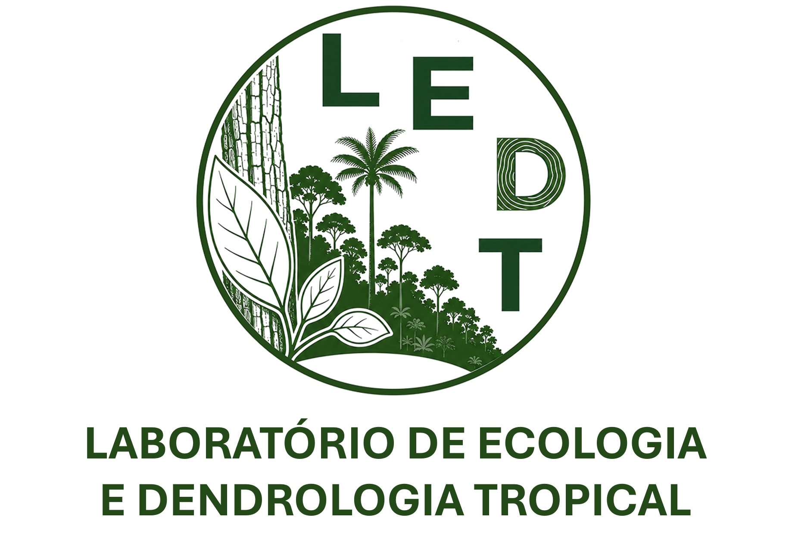
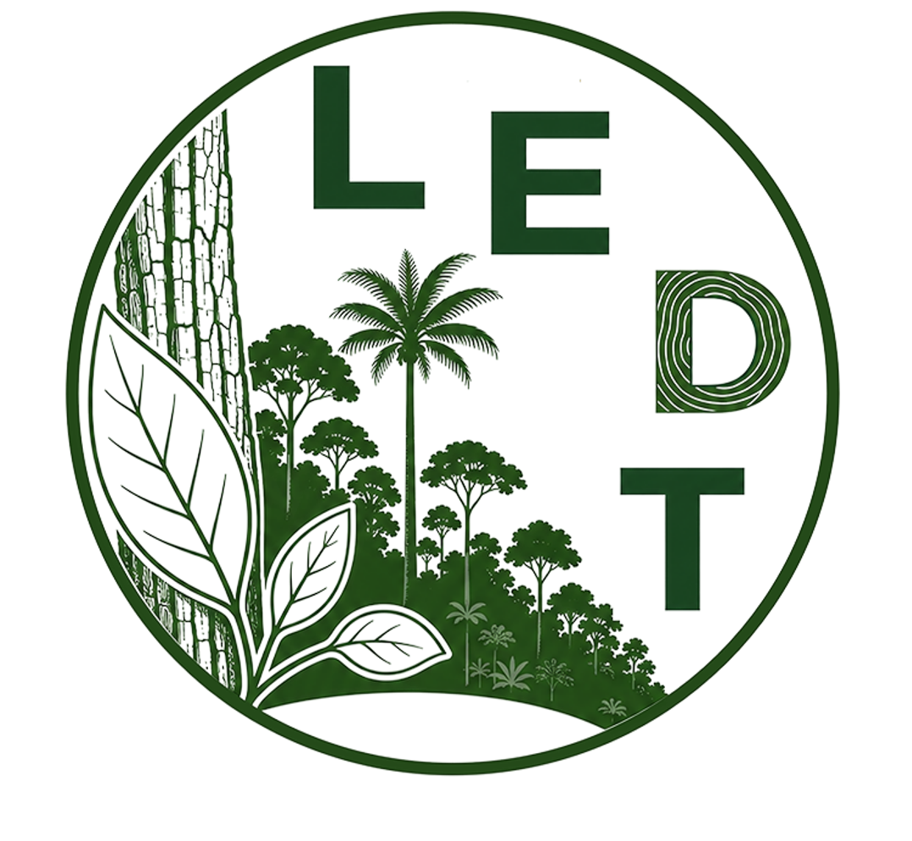

Use os arquivos desta página em apresentações, pôsteres, relatórios e materiais de divulgação ligados ao LEDT. Clique em **Baixar** para salvar o arquivo em alta resolução.

## Logos do LEDT

::: grid
::: {.g-col-12 .g-col-md-4}
::: {.card .h-100 .text-center}
{fig-alt="Logo horizontal do LEDT" .p-3}

::: card-body
**Horizontal**\
Uso preferencial: slides, rodapés, sites.

<a href="assets/images/logos/logo_horizontal.png" download class="btn btn-outline-success btn-sm"><i class="bi bi-download"></i> Baixar PNG</a>
:::
:::
:::

::: {.g-col-12 .g-col-md-4}
::: {.card .h-100 .text-center}
{fig-alt="Logo vertical do LEDT" .p-3}

::: card-body
**Vertical**\
Uso: pôsteres, capas, banners.

<a href="assets/images/logos/logo_vertical.png" download class="btn btn-outline-success btn-sm"><i class="bi bi-download"></i> Baixar PNG</a>
:::
:::
:::

::: {.g-col-12 .g-col-md-4}
::: {.card .h-100 .text-center}
{fig-alt="Símbolo do LEDT" .p-3}

::: card-body
**Símbolo**\
Uso: espaços pequenos, ícones, redes sociais.

<a href="assets/images/logos/logo_simples.png" download class="btn btn-outline-success btn-sm"><i class="bi bi-download"></i> Baixar PNG</a>
:::
:::
:::
:::

### Cor principal

::: {.d-flex .align-items-center .gap-3 .my-3}
[]{style="display:inline-block;width:56px;height:56px;border-radius:8px;background:#234a18;"}

**Verde LEDT** · HEX `#234A18` · RGB 35, 74, 24
:::

### Boas práticas

-   Não distorça, recorte, gire ou mude as cores do logo.
-   Mantenha uma margem livre ao redor do logo e use-o sobre fundos claros.
-   Ao usar o LEDT junto com outras instituições, mantenha os logos com tamanhos visualmente equivalentes.

## Logos institucionais

Logos das instituições às quais o LEDT está vinculado e das parceiras, para uso em apresentações e pôsteres.

<!--
PASTA DO DRIVE: crie a pasta "LEDT – Identidade visual" no Google Drive do lab,
deixe com acesso "Qualquer pessoa com o link – Leitor", cole o link abaixo
e apague as marcas de comentário (<!- - e - ->) desta seção.

<a href="COLE_AQUI_O_LINK_DA_PASTA" target="_blank" class="btn btn-success"><i class="bi bi-google"></i> Pasta de logos institucionais no Drive</a>
-->

::: {.callout-note appearance="simple"}
Cada instituição tem regras próprias para o uso da sua marca. Na dúvida, baixe a versão oficial:

-   **UFAM:** [Identidade Visual UFAM](https://www.ufam.edu.br/identidade-visual-ufam.html) · [Manual de Identidade Visual (Edoc)](https://edoc.ufam.edu.br/handle/123456789/1996)
-   **INPA:** solicite à Assessoria de Comunicação do INPA ou consulte o [portal do INPA](https://www.gov.br/inpa/pt-br)
:::
