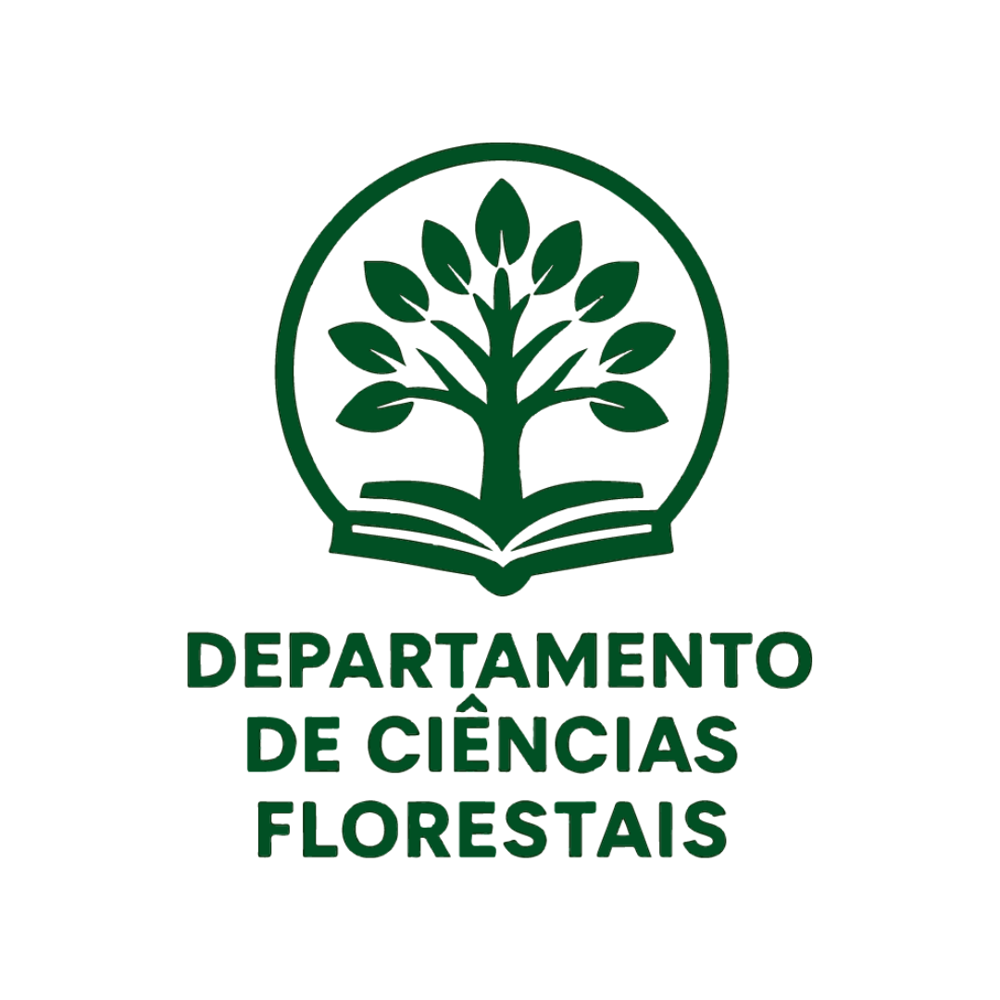
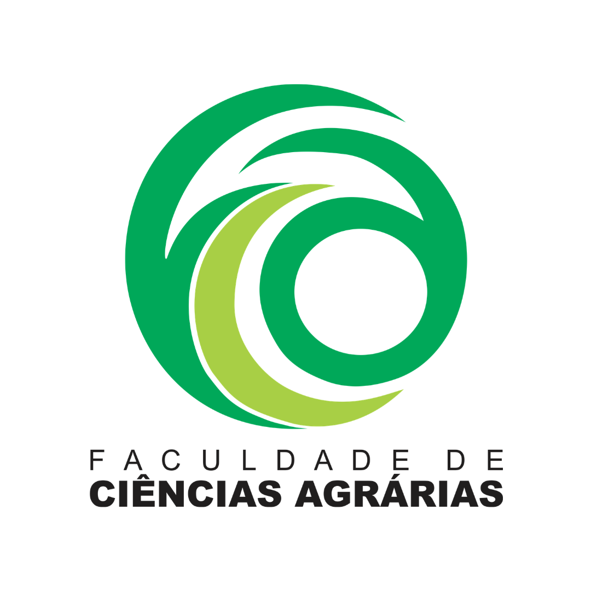
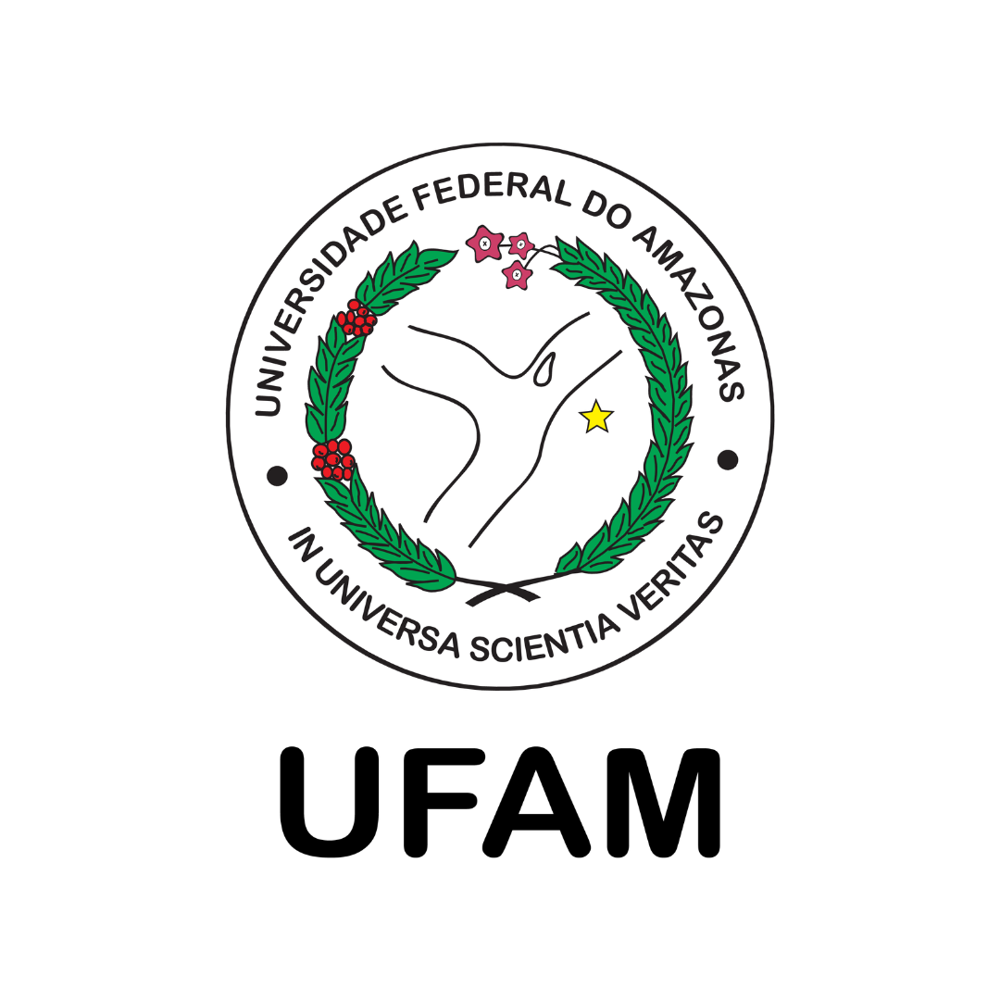

No **Laboratório de Ecologia e Dendrologia Tropical (LEDT)**, estudamos a diversidade, a ecologia e a taxonomia das árvores amazônicas. Combinamos trabalho de campo, coleções de herbário, espectroscopia, monitoramento ecológico e abordagens analíticas integrativas para investigar a identificação de espécies, padrões de biodiversidade e as respostas das florestas tropicais às mudanças climáticas.

Com sede na Universidade Federal do Amazonas (UFAM), em Manaus, Brasil, nosso grupo colabora com redes de pesquisa nacionais e internacionais para promover a compreensão, a documentação e a conservação da biodiversidade amazônica.

{fig-alt="Logo do LEDT" width="100%"}

::: {.grid .home-cards}
::: {.g-col-12 .g-col-md-4}
### <i class="bi bi-mortarboard"></i> Ensino

Disciplinas de graduação e pós-graduação, ementas e materiais.

[Ver disciplinas](ensino/graduacao/disciplinas.qmd){.btn .btn-outline-success .btn-sm}
:::

::: {.g-col-12 .g-col-md-4}
### <i class="bi bi-search"></i> Pesquisa

Projetos, parcerias, redes de colaboração e publicações.

[Ver pesquisa](pesquisa.qmd){.btn .btn-outline-success .btn-sm}
:::

::: {.g-col-12 .g-col-md-4}
### <i class="bi bi-code-slash"></i> R Lab

Rotinas em R para ecologia, dendrologia e espectroscopia.

[Ver rotinas](extensao/rlab/index.qmd){.btn .btn-outline-success .btn-sm}
:::
:::

## Últimas notícias

::: {#noticias}
:::

[Ver todas as notícias](divulgacaocientifica.qmd){.btn .btn-outline-success .btn-sm}

------------------------------------------------------------------------

::: {style="text-align:center"}
#### O LEDT é apoiado por
:::

::: columns
::: {.column width="33%"}
{fig-align="center" width="150" fig-alt="Departamento de Ciências Florestais"}
:::

::: {.column width="33%"}
{fig-align="center" width="150" fig-alt="Faculdade de Ciências Agrárias"}
:::

::: {.column width="33%"}
{fig-align="center" width="150" fig-alt="Universidade Federal do Amazonas"}
:::
:::
